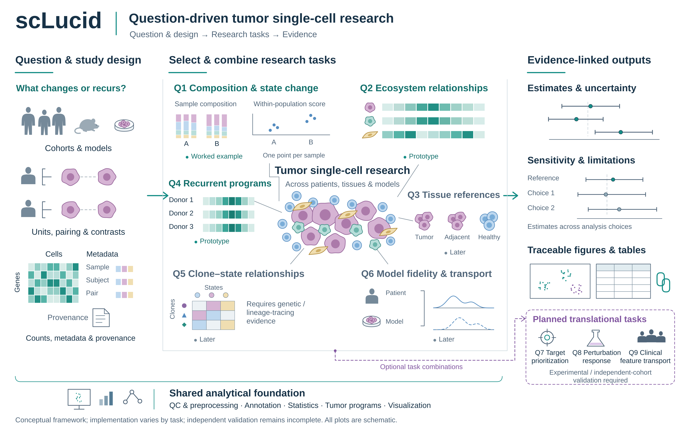

# scLucid

### A question-driven framework for tumor single-cell research

[](https://badge.fury.io/py/sclucid)
[](https://opensource.org/licenses/MIT)
[](https://github.com/yelu61/scLucid/actions)

**Start with a research question. Connect study design, analysis and evidence.**

scLucid is a Python framework for tumor single-cell transcriptomics in
multi-patient clinical cohorts and experimental tumor models. It organizes
recurring research questions into reusable tasks that connect eligible inputs,
shared analysis methods, sample-level evidence, sensitivity checks and research
figures. Each task makes its assumptions and interpretation limits explicit.

**中文定位：** scLucid 是面向多患者临床队列与肿瘤实验模型的单细胞转录组研究框架。它以具体研究问题与研究设计为入口，将分析方法、样本级证据、敏感性评估与研究图表连接为可复用的研究任务。

> **Development status:** this page presents the current framework direction
> and local development progress. The published GitHub code and detailed docs
> are an earlier snapshot. The Q1 example, Q2/Q4 additions and revised task
> cards described below have not yet been synchronized to GitHub; cloning this
> repository does not currently provide those additions. This README update
> is not a code release or a scientific-validation milestone.

[](docs/assets/sclucid_question_driven_framework.png)

*Framework map: tasks are selected and combined for the study; they are not a
mandatory Q1-to-Q9 pipeline. The map includes intended capabilities as well as
bounded implementations. All plotted values are schematic. See
[Research questions](#research-questions) for the scope of each task. Click the
image to view it at full resolution.*

**[Get started](#get-started)** · **[Research questions](#research-questions)** ·
**[Worked Q1 example](#run-a-research-task)** · **[Documentation](docs/README.md)** ·
**[Roadmap](docs/roadmap/index.md)**

## Research questions

The question defines the comparison, required evidence and useful outputs.
A cancer type, treatment or cell population supplies the project context.

| Task | Question it is designed to address |
| --- | --- |
| **Q1 · Composition and state change** | Do conditions or real follow-up visits differ in cellular composition, within-population programs, or both? |
| **Q2 · Ecosystem relationships** | Which tumor and microenvironment features co-vary across samples, and which relationships replicate? |
| **Q3 · Tissue references** | How do tumor, adjacent and healthy tissue differ under a compatible reference design? |
| **Q4 · Recurrent programs** | Which expression programs recur across patients and independent studies? |
| **Q5 · Clone–state relationships** | How do genetic clones, receptor clonotypes or lineage labels relate to expression states? |
| **Q6 · Model fidelity and transport** | Which human disease features are represented in a model, and which model findings transfer to humans? |
| **Q7 · Target prioritization** | Which targets merit experiments given patient coverage and normal-tissue expression risk? |
| **Q8 · Perturbation response** | How might a specified intervention affect a defined population, and which predictions merit experimental testing? |
| **Q9 · Clinical feature transport** | Do frozen single-cell features transfer to independent clinical cohorts and retain their intended outcome relevance? |

**Current scope at a glance — this catalog does not imply nine completed workflows:**

- **Q1 · Worked example in local development:** independent or genuinely paired two-condition
  comparisons, with scoped CRC application and reuse evidence.
- **Q2 / Q4 · Bounded local prototypes:** ecosystem relationships and recurrent
  programs, respectively; independent scientific validation remains unfinished.
- **Q3 / Q5 / Q6 · Later or external-evidence tasks:** reference comparisons,
  clone–state relationships and model fidelity require further task development.
- **Q7–Q9 · Planned:** no complete executable tasks declared. Virtual-cell
  models are candidate methods within Q8, subject to context-specific evaluation.

Detailed maturity, supported branches and stop rules are maintained in the
local task cards pending publication. Q1's scoped execution and reuse also
remain distinct from independent scientific validation.

## How the framework works

1. **Define the question and design.** Declare the biological unit, specimens,
   conditions, real pairing or time points, and the comparison of interest.
2. **Prepare eligible inputs.** Review counts, QC, expression representations
   and cell identities. Preserve provenance when using externally prepared data.
3. **Select and combine tasks.** Reuse methods appropriate to the design. For
   example, Q4 can define program features for Q1, while Q2 can examine their
   sample-level relationships with the microenvironment.
4. **Inspect the evidence.** Read effects, uncertainty, coverage, sensitivity
   and non-estimable results alongside linked source tables and figures.
   Add independent functional, spatial or clinical evidence where the claim
   requires it.

Tasks share QC, preprocessing, annotation, statistical analysis, tumor-program
and visualization capabilities. Mature ecosystem tools can supply optional
methods and evidence. Task composition depends on compatible inputs and
measurement definitions; it does not require every task or modality.

## What scLucid brings to a project

| Principle | Practical consequence |
| --- | --- |
| **Question-led analysis** | Study design and intended outputs guide which methods to use. |
| **Composition and state stay distinct** | Population abundance and within-population expression answer separate questions and retain their own denominators. |
| **Biological units stay explicit** | Patients or animals, specimens and cells have different roles; more cells do not create more independent replicates. |
| **Reviewable decisions** | QC and preprocessing expose a recommendation before an explicit policy is applied, with parameters, warnings and provenance retained. |
| **Evidence-linked interpretation** | Task outputs connect estimates and figures to source rows, sensitivities and unresolved evidence gaps. |
| **Reusable foundations** | Stepwise examples and existing APIs support project-specific analyses; optional dependencies are added when needed. |

These are design commitments and scoped implementation features. Comparative
benefits require their own evaluation; no universal performance advantage is
claimed.

## Get started

### Install

For an editable installation of the published GitHub snapshot:

```bash
git clone https://github.com/yelu61/scLucid.git
cd scLucid
pip install -e ".[analysis,de]"
```

For a published package installation:

```bash
pip install sclucid
```

The Python import is **`import scLucid as scl`** (capital `L`), matching the
source package directory `src/scLucid/`.

Optional extras cover annotation and clustering (`analysis`), differential
expression (`de`), experimental cNMF programs (`programs`, local development), integration,
CNV, velocity, bulk and spatial support. Install only those required by the
chosen workflow; see the [installation guide](docs/user/installation.md).
Uncommitted local work is available only in its local editable checkout, and
published packages may differ from the current development documentation.

The `velocity` extra supports optional RNA-velocity methods. Their possible
role in candidate state-transition analyses combining Q1/Q4/Q5
is a design direction, not a validated transition workflow. Velocity or
pseudotime alone does not establish lineage, reversibility or resistance.

### Prepare a dataset

Start from an AnnData object with verified count provenance and real sample
metadata. In this example, `sample`, `patient` and `condition` are existing
columns in `adata.obs`; replace them with the corresponding project columns.
The input must retain raw counts in `layers["counts"]`.

```python
import scanpy as sc
import scLucid as scl

adata = sc.read_h5ad("data/cohort_counts.h5ad")
context = scl.ProjectContext(
    dataset_type="tumor_tissue",
    species="human",
    sample_key="sample",
    experimental_unit_key="patient",
    condition_key="condition",
    input_provenance="filtered_counts",
)

# Review the recommendation, reason and required next action.
qc_review = scl.recommend_qc_policy(adata, context=context)
print(qc_review.status, qc_review.reason, qc_review.next_action)
```

After reviewing the recommendation and resolving any blocking issue, explicitly
apply the policy and review the next stage:

```python
qc_result = scl.apply_qc_policy(adata, qc_review.policy)

pp_review = scl.recommend_preprocess_policy(
    qc_result.adata, context, consumer="exploration"
)
print(pp_review.status, pp_review.reason, pp_review.next_action)

# Apply after reviewing this stage's policy and unresolved issues.
pp_result = scl.apply_preprocess_policy(qc_result.adata, pp_review.policy)
```

Declare `paired_key` when genuine pairing exists and `batch_key` only for a
known technical batch. `recommend_*` leaves its input unchanged; `apply_*`
checks the reviewed input fingerprint and returns the output in `result.adata`.
The exploration representation above is preparation for inspection; each
downstream statistical method still needs its appropriate expression input.
See the [review/apply workflow](docs/user/evidence_calibrated_workflow.md) and
[data contracts](docs/user/data_contracts.md).

### Run a research task

**Local development preview:** this example and its task card are not yet in
the published GitHub snapshot. The command and output layout below describe
the development checkout containing `examples/02_key_api/q1_composition_state.py`.

The Q1 worked example separates
captured-cell composition from fixed within-population score changes. It is a
stepwise Python script driven by a JSON study specification; the command below
runs those same steps from the terminal.

To continue from `pp_result.adata`, first review the cell-population annotations
and compute the prespecified program scores using an appropriate expression
representation. Store the population labels and per-cell scores in the prepared object’s
`.obs`, then save that annotated object as H5AD. In the JSON specification, point
`input_path` to this file, map the metadata and score columns, and record the
score definitions and provenance. Preprocessing alone does not supply these
annotations or scores, and the Q1 script does not infer them.

In that development checkout, read the Q1 task card in
`docs/CLAIM_EVIDENCE_MAP.md` before creating the project specification.
Set `SCLUCID_Q1_OUT` to a new or empty
directory; existing results are protected from overwrite.

```bash
SCLUCID_Q1_SPEC=/path/to/q1_spec.json \
SCLUCID_Q1_OUT=/path/to/new_results \
python examples/02_key_api/q1_composition_state.py
```

A completed run writes the following linked outputs directly to
`SCLUCID_Q1_OUT`:

```text
new_results/
├── sample_design.csv               # Specimens, biological units and conditions
├── population_features.csv         # Sample/population abundance, scores and eligibility
├── abundance_state_effects.csv     # Separate abundance/state rows, intervals and test status
├── sensitivity_full.csv            # Full-data comparison for the sensitivity analysis
├── sensitivity_omissions.csv       # Every leave-one-unit-out result, including failures
├── sensitivity_summary.csv         # Effect shifts and influential omissions
├── specification.json              # Study specification used for this run
├── figure_legends.txt              # Design, denominators and interpretation limits
├── sample_observations_*.{pdf,svg,png}
├── effects_*.{pdf,svg,png}
└── run.json                        # Execution record, provenance and output hashes
```

Here `*` denotes a contrast/population/score page identifier; each figure page
is saved in all three formats. Abundance and state estimates are separate rows
in one effects table. Coverage and eligibility are retained in the source
tables and figure-page records. `run.json` records execution completion
separately from scientific performance (`NOT_EVALUATED`).

The current entrypoint supports
independent or genuinely paired two-condition comparisons. Adjusted,
multi-visit and treatment-benefit models are outside that entrypoint's scope.
For composition alone, use the proportion/comparison APIs without inventing a
state score.

For the currently published interactive examples, see the
[notebook guide](docs/user/notebooks.md). Existing plan/pipeline
and stage APIs remain available with their own execution contracts; see
[usage layers](docs/user/usage_layers.md).

## Evidence and development boundaries

scLucid is under active development. A runnable example, an engineering check
and independent scientific validation establish different things. QC and
preprocessing remain **`REVIEW`** under their existing scientific and
real-project usability gates; scoped task execution does not promote the
whole framework to validated status.

- **Associations retain their meaning.** Co-variation does not establish
  functional communication, spatial proximity or causality.
- **Expression retains its limits.** Cell identity alone does not establish
  malignancy; an RNA program or target score does not establish drug response,
  a therapeutic window or clinical utility.
- **Additional evidence is conditional.** Spatial, lineage, protein,
  perturbation and clinical-outcome data extend a task only when available,
  compatible and relevant to the claim.
- **Generalization is evaluated separately.** Human and mouse studies,
  discovery and independent evaluation, and measurement transfer and outcome
  prediction require their own evidence.

Current implementation and evaluation records are maintained in the
[claim–evidence map](docs/CLAIM_EVIDENCE_MAP.md),
[maturity guide](docs/user/qc_preprocess_maturity.md) and
[roadmap](docs/roadmap/index.md).

## Documentation

These links lead to the currently published documentation snapshot. Its
positioning, roadmap and task coverage predate the local development described
above and will be synchronized with the corresponding code.

| Start here | Reference |
| --- | --- |
| Learn the framework | [Documentation home](docs/README.md) · [Positioning and design](docs/SCLUCID_STRATEGIC_IMPLEMENTATION_PLAN.md) |
| Choose a question | [Q1–Q9 overview and scope](#research-questions) |
| Prepare and inspect data | [Quickstart](docs/user/quickstart.md) · [Project context](docs/user/project_context.md) · [Reviewing results](docs/user/reviewing_results.md) |
| Work through an analysis | [Examples](docs/user/examples.md) · [Notebooks](docs/user/notebooks.md) · [Best practices](docs/user/best_practices.md) |
| Use specific functions | [API reference](docs/api/) · [Data contracts](docs/user/data_contracts.md) |
| Check scope and progress | [Roadmap](docs/roadmap/index.md) · [Documentation policy](docs/CURRENT_IMPLEMENTATION_AND_DOCS_POLICY.md) |

## Contributing

Contributions that improve task usability, evidence quality, reproducibility or
documentation are welcome. See the [contributing guide](docs/CONTRIBUTING.md)
and [issue tracker](https://github.com/yelu61/scLucid/issues).

## Citation and license

Until a formal methods paper is available, cite the repository and report the
package version or commit used for your analysis. A manuscript citation will be
added when available.

scLucid is released under the [MIT License](LICENSE).
